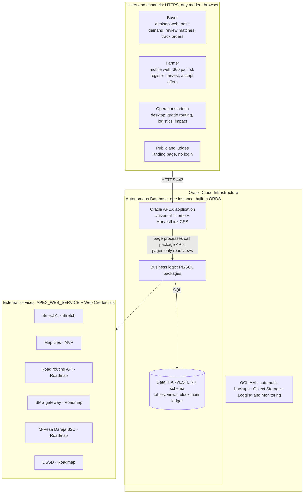
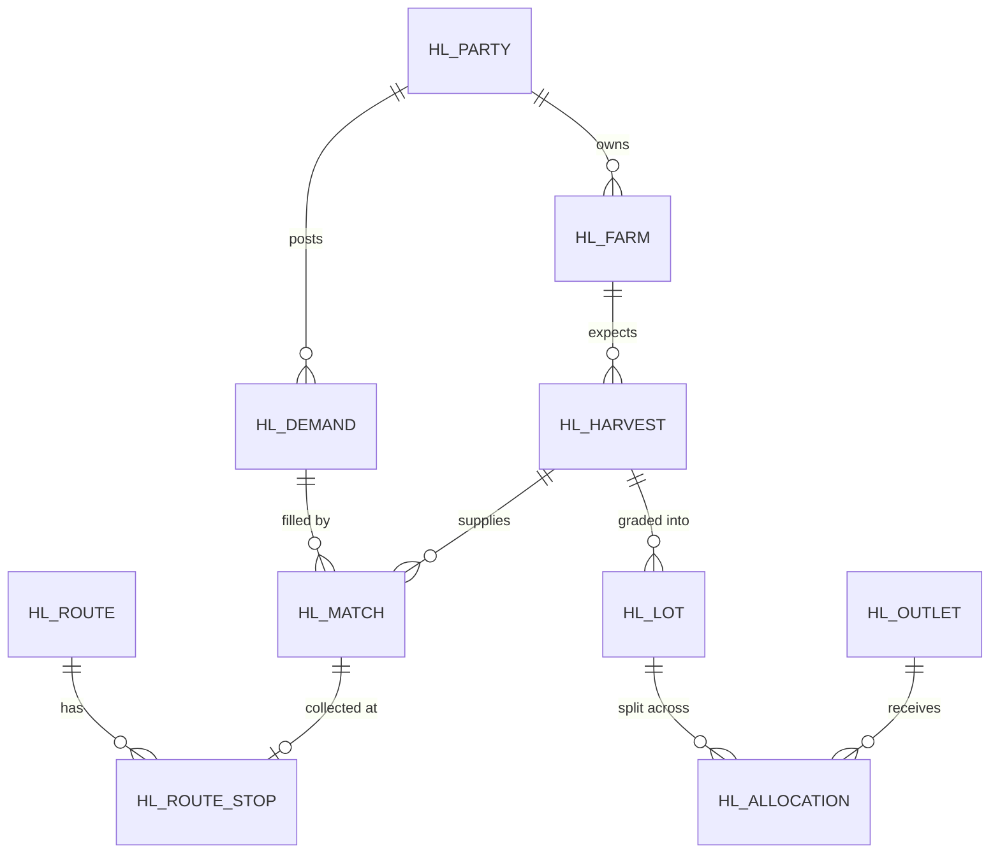
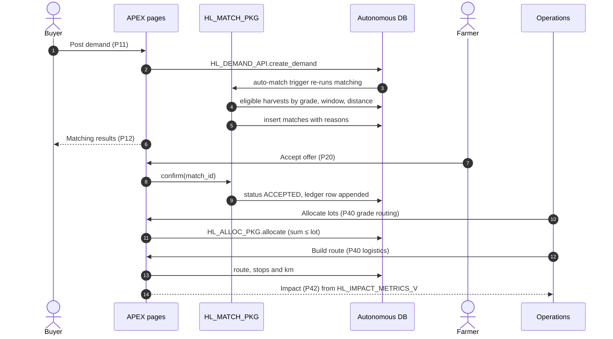

# HarvestLink system architecture

One Oracle APEX application on Autonomous Database. All matching, grade routing, route planning and impact
maths run as PL/SQL next to the data, so every number on screen comes from a query a judge can inspect.

This is the target architecture the frontend and backend build towards. **Status** columns say what exists in
this repository today: **Built**, **Partly built**, **Planned** (a later backend PR, see
[`backend-api.md`](backend-api.md#planned-backend-prs)), **Stretch** (if time allows) or **Roadmap** (after the
hackathon). Where the build differs from the original plan, an *As built* note says how.

Tags used for capabilities: **MVP** built for the demo · **Simulated** stand-in, labelled in the UI ·
**Stretch** if time allows · **Roadmap** after the hackathon.

## 1 · System overview

| Layer | Status | As built |
|---|---|---|
| Autonomous Database, built-in ORDS and APEX | Built | Always Free Transaction Processing, Autonomous AI Database 26ai, APEX 26.1, region **eu-frankfurt-1** (the plan suggested a region near Kenya such as Johannesburg; Frankfurt is the tenancy's home region) |
| APEX application | Partly built | 14 pages generated from `apex/harvestlink-blueprint.md`; the canvas screens are the frontend work in progress |
| PL/SQL business logic | Partly built | See section 3 |
| Agreement ledger | Built | Oracle blockchain table `HL_AGREEMENTS`, added after the original plan |
| Infrastructure as code | Built | `infra/`: one `terraform apply` provisions the database and wallet and builds schema, data and app |

## 2 · APEX application: canvas screens mapped to pages

| Target page | Screen | Main regions | Reads / writes | Status |
|---|---|---|---|---|
| `P1` | Landing (public) | Static content, metric cards | `HL_IMPACT_METRICS_V`, `HL_FULFIL_V` | Backend ready; page planned |
| `P100` | Role selection (public) | Three role cards; farmer sign-up (name, phone, ward) | farmers, buyers | Planned (roles PR) |
| `P10` | Buyer dashboard | Report with status facets, fulfilment component | `HL_FULFIL_V`, `HL_MATCH_V` | Backend ready |
| `P11` | Create demand | Form, validations, after-submit `HL_DEMAND_API.create_demand` | demands → matches | Backend ready |
| `P12` | Matching results | Cards (MatchCard), fulfilment bar, "Not matched" | `HL_MATCH_V`, `HL_FULFIL_V`, `HL_NEAR_MISS_V` | Backend ready |
| `P20` | Farmer dashboard | Next pickup, offers (accept/decline), harvest form | `HL_HARVEST_API`, `HL_MATCH_PKG.confirm/decline` | Backend ready |
| `P30` | Order details | Timeline, parties, reasons, route stops | `HL_MATCH_V`, route stops | Partly (stops planned) |
| `P40` | Operations (tabs) | Grade routing (grid + bar) · Logistics (map + summary) | `HL_GRADE_ROUTING_V`, routes | Read ready; allocation and stops planned |
| `P42` | Sustainability impact | Metric cards with method notes | `HL_IMPACT_METRICS_V` | Backend ready |

The current blueprint app also has admin pages (demands, harvests, farmers, buyers, match planner, grade
routing, agreement ledger) that stay available behind the canvas screens.

**Authentication and roles** (Planned, roles PR)

- APEX Accounts; demo users `buyer_demo`, `farmer_demo`, `ops_demo`. *As built today:* a developer login and an
  end-user judge login.
- Authorization schemes `IS_BUYER`, `IS_FARMER`, `IS_OPS`; each navigation list and page gated.
- Application item `G_PARTY_ID` set at login; every query filters on it.

**Look and feel** (Built)

- Universal Theme restyled with the canvas tokens: `apex/theme/harvestlink.css`, added to the app as a static
  application file on every build, plus app icons from the HarvestLink mark.
- Provenance tags on every impact figure come from the `provenance` column of `HL_IMPACT_METRICS_V`.

## 3 · Business logic: PL/SQL packages

Pages stay thin. Each package exposes a small API that the APEX pages and automations call, which also makes the
logic testable.

| Package | Key procedures | Rules it enforces | Status |
|---|---|---|---|
| `HL_DEMAND_API` | `create_demand`, `cancel`, `close_if_filled` | Qty > 0 and ≤ 50 t; delivery ≥ today + 7 days; stores kg only | Built |
| `HL_HARVEST_API` | `register`, `update_estimate` | Window end ≥ start; start ≥ today; editable until a match is accepted | Built |
| `HL_MATCH_PKG` | `run`, `confirm`, `decline`, `rerun_open` | Eligibility (grade, window, freshness, radius), weighted ranking, greedy allocation, plain-language reasons | Built |
| `HL_ALLOC_PKG` | `allocate(p_lot_id, p_outlet_id, p_kg)`, `lock_week` | `SUM(alloc_kg) ≤ lot_kg` per lot, under a row lock | Planned |
| `HL_ROUTE_PKG` | `build`, `separate_km` | Nearest-neighbour stop order; distance = straight-line × 1.3 (labelled simulated) | Partly: inside `HL_MATCH_PKG.plan_route` (vehicle choice, km and CO₂ saved); stops table planned |
| `HL_IMPACT_PKG` | metrics + method text | Each metric = formula × factor, with provenance | Built as views `HL_IMPACT_V`, `HL_IMPACT_METRICS_V` |
| `HL_DEMO` | `seed`, `reset` | Restores the Kirinyaga dataset so the live demo always starts clean | Built (PR #2) |

## 4 · Data model

All quantities in kilograms; all money in KES. The plan models locations as `SDO_GEOMETRY` points with a spatial
index; *as built*, farms and buyers store latitude and longitude and distances use the haversine formula × the
road factor.

Target model:

As built (table names the API views sit on):

| Target | As built | Notes |
|---|---|---|
| `HL_PARTY` + `HL_FARM` | `HL_FARMERS`, `HL_BUYERS` | One farm per farmer for now |
| `HL_DEMAND` | `HL_DEMANDS` | |
| `HL_HARVEST` | `HL_HARVESTS` | One row per grade, so lots are implicit |
| `HL_MATCH` | `HL_MATCHES` | Status `PROPOSED`, `ACCEPTED`, `REJECTED`, `DELIVERED`; shown to the UI as `PENDING`, `MATCHED`, `DECLINED` by `HL_MATCH_V` |
| `HL_LOT`, `HL_OUTLET`, `HL_ALLOCATION` | Not yet | Grade allocation PR |
| `HL_ROUTE`, `HL_ROUTE_STOP` | `HL_ROUTES` (one per demand) | Stops table planned |
| `HL_IMPACT_FACTOR` | `HL_SETTINGS` | Weights, road factor, capacities, emission factors, loss rate |
| `HL_EVENT_LOG` | `HL_AGREEMENTS` (blockchain table) | Covers match confirmations, rejections and deliveries |

**Integrity in the database, not just the UI**

- Check constraints: grade in A, B, C; quantities > 0; harvest end ≥ start.
- Unique `(demand_id, harvest_id)` on matches: a harvest is matched once per demand.
- A harvest's matched kg across all demands never exceeds its estimate (`available_kg`).
- Agreements cannot be updated or deleted (blockchain table, hash-chained rows).

**Views the pages read** (contract in [`backend-api.md`](backend-api.md)): `HL_MATCH_V`, `HL_FULFIL_V`,
`HL_NEAR_MISS_V`, `HL_IMPACT_METRICS_V`, `HL_GRADE_ROUTING_V`, `HL_DEMAND_SUMMARY_V`, `HL_AGREEMENTS_V`. Phone
numbers are masked in `HL_MATCH_V` until the farmer confirms.

## 5 · Demo flow

## 6 · Matching logic

Hard rules decide eligibility; weighted scores order the eligible farms; the reasons are what the UI shows.

1. **Grade must meet the request.** A better grade qualifies but scores lower, keeping premium produce for
   premium buyers. Lower grades are not dropped; they go to grade routing.
2. **Harvest window must work.** Harvest must start by the delivery date and still be fresh on delivery (crop
   shelf life).
3. **Quantity fit.** Share of the remaining kg this farm can cover; bigger shares mean fewer stops.
4. **Distance.** Road km (straight-line × 1.3) to the delivery point, within a radius (`MAX_DISTANCE_KM`).
5. **Greedy allocation.** Walk the ranked list, allocate `LEAST(available, remaining)` until the demand is filled.
6. **Shared route.** Nearest-neighbour pickup tour; truck or pickup, whichever emits less, or direct delivery if
   pooling does not help.

Matching re-runs automatically whenever demands, harvests or farm locations change, earliest deadline first.

**Select AI (Stretch):** the reasons are already plain sentences, so Select AI is optional. If added, use it to
turn the four reasons into one sentence in English or Kiswahili, and for operations to ask questions such as
"which demands are short this week?", always beside the rule-based reasons, never replacing them.

## 7 · Security and privacy

**Access**

- Role-based authorization on every page, region and process; farmers see only their own harvests and offers
  (Planned, roles PR).
- Session state protection on; items checksum-protected.
- APEX parses as the `HARVESTLINK` schema with no DBA rights; ADMIN is used only by the bootstrap script.
- Secrets live outside the repository (`~/.config/harvestlink/secrets.env`); Terraform state and wallets are
  git-ignored.

**Privacy (Kenya Data Protection Act, 2019)**

- Farmer records hold name, phone, location and consent only; no ID number or date of birth.
- Phone numbers masked to buyers until the farmer accepts (`HL_MATCH_V`).
- Consent captured per farmer at sign-up: `consent_given`, plus the version of the notice agreed to
  (`consent_version`, text in `HL_CONSENT_TEXTS`) and when (`consent_at`).
- Right of access: `hl_farmer_api.export_data` returns everything held about a farmer as JSON.
- Right to deletion: `hl_farmer_api.delete_account` removes the farmer, their harvests, offers, allocations, pickup
  stops and login mapping from every table and view at once. The exception is the agreement ledger
  (`HL_AGREEMENTS`, a blockchain table): rows already written keep the name and phone and cannot be changed or
  deleted for 16 days; rows written during and after deletion carry only a pseudonym. `HL_ERASURES` records when each
  farmer's rows may be purged, and `hl_farmer_api.purge_ledger` purges them (see `docs/backend-api.md`).
- The agreement ledger records who confirmed, rejected or delivered each match, and when.

## 8 · Deployment and DevOps

| Topic | Plan | As built |
|---|---|---|
| Environments | Dev workspace; Demo workspace frozen 24 h before judging | One Always Free database; `hl_demo.reset` before rehearsals |
| Source control | SQLcl export and DDL committed to Git | DDL, the app blueprint and generated APEXlang in Git; one branch and PR per change |
| Rebuild from scratch | Liquibase changesets | `terraform apply` drops and rebuilds the schema when `db/` changes and re-imports the app when `apex/` changes |
| Demo safety | `HL_DEMO.reset` before every rehearsal | Built |
| Fallback | Recorded 3-minute walkthrough in case the venue network fails | To record |

## 9 · Scope

| Capability | Hackathon | How | Status |
|---|---|---|---|
| Demand and harvest forms | MVP | APEX pages + `HL_DEMAND_API`, `HL_HARVEST_API` | Built (admin forms); canvas forms in progress |
| Explainable matching with reasons | MVP | `HL_MATCH_PKG`, `HL_MATCH_V` | Built |
| Tamper-evident agreements | MVP | Blockchain table `HL_AGREEMENTS` | Built |
| Grade routing with no double-counting | MVP | `HL_ALLOC_PKG` + Interactive Grid | Suggestions built; allocation planned |
| Map of pickups, cluster and route | Simulated | APEX Map region; straight-line × 1.3 | Built (match planner map) |
| Impact dashboard with methods | MVP + demo factors | `HL_IMPACT_METRICS_V` | Built |
| Role-based pages and demo users | MVP | Authorization schemes, `G_PARTY_ID` | Planned |
| Plain-language AI explanations | Stretch | Select AI | Not started |
| SMS offers, USSD, M-Pesa payouts, live GPS | Roadmap | Africa's Talking, Daraja B2C, routing API | Roadmap |

## 10 · Risks on demo day

| Risk | Mitigation |
|---|---|
| Venue Wi-Fi drops mid-demo | Phone hotspot; recorded walkthrough ready |
| Demo data left half-finished | `hl_demo.reset` before presenting |
| Map tiles slow to load | Pre-load the logistics page before presenting |
| Judges question impact numbers | Every metric shows formula, factor and provenance |
| Select AI quota or credentials fail | Feature is additive; rule-based reasons always render |
| Always Free database stops after 7 days without activity | Open the app the day before and the morning of judging |
